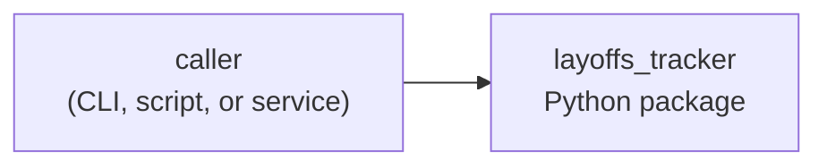

# Architecture — layoffs-tracker

## One-line
Monthly tracker of AI-cited layoffs in SEC filings and WARN notices

## System diagram

> Refine this diagram as the system shape settles. GitHub renders Mermaid natively.

## Components

### `src/layoffs_tracker/`
The package. `core.py` holds day-one placeholder logic; replace it with the first feature.

## Decisions
See [`./decisions/`](./decisions/) for the running ADR log.

## Open questions
- (Track unresolved design questions here. Move to an ADR once decided.)
