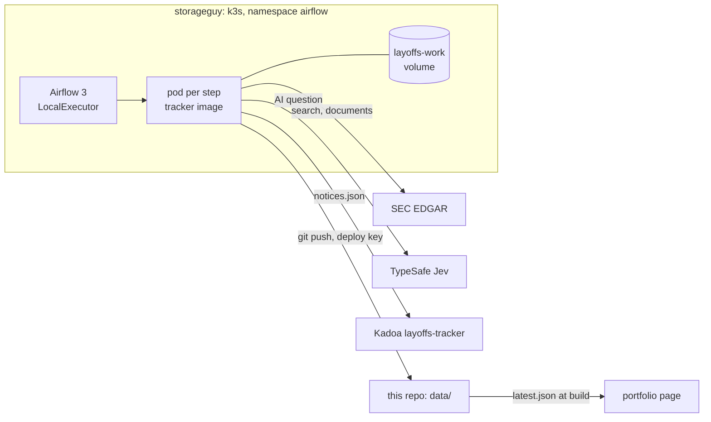

# Architecture — layoffs-tracker

## One-line
Monthly tracker of AI-cited layoffs in SEC filings and WARN notices

## System diagram

## Components

### `src/layoffs_tracker/`
One CLI, `layoffs-tracker <step> --work DIR`, a subcommand per DAG task. `sec.py` searches
and extracts Item 2.05 filings; `jev/` labels new ones (AI question only); `warn.py` builds the
national WARN series; `metrics.py` writes `latest.json`; `publish.py` merges and pushes;
`seed.py` rebuilds the paper's history.

### `dags/`
`layoffs_monthly`: six KubernetesPodOperator tasks, 09:00 America/Denver on the 3rd.

### `infra/`
Helm values (chart 1.22.0, Airflow 3.2.2), the namespace and volume, and the server runbook.

### `data/`
`filings.parquet` (paper rows frozen through Sep 2026, Jev rows after) and `latest.json`.

## Decisions
See [`./decisions/`](./decisions/) for the running ADR log.

## Open questions
- (Track unresolved design questions here. Move to an ADR once decided.)
